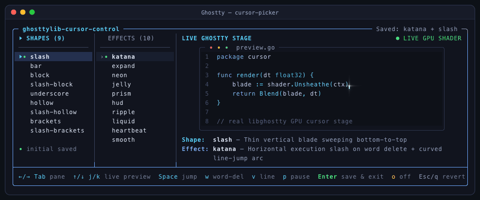

# ghosttylib-cursor-control

GPU-accelerated custom cursor shader library, CLI controller, and live interactive picker for **[Ghostty](https://ghostty.org)** — built with **100% orthogonal Shapes × Effects** so any of the **10 curated effects** can mix freely with any of the **9 cursor shapes** (`90` combinations) without interfering.

Works across standard shells (`zsh`, `bash`, `fish`), terminal editors (`nvim`, `helix`), and full-screen TUI applications, and **persists automatically** across Ghostty restarts.

> [!NOTE]
> **Terminal Compatibility:** Currently supports standalone **[Ghostty](https://ghostty.org)** only (macOS & Linux). Other `libghostty`-based apps (such as `Rex Beta`) do not yet load external `custom-shader` `.glsl` files from disk, and other terminals (`WezTerm`, `Alacritty`, `iTerm2`, etc.) do not expose Ghostty's cursor shader uniform pipeline.



---

## Quick Start

```bash
# Launch the interactive Go TUI picker (renders Ghostty's REAL GPU cursor shaders live!)
./cursor-picker
# (or simply run `./cursorctl` with no arguments / `./cursorctl pick`)

# Or link & switch directly from the CLI (auto-reloads Ghostty via SIGUSR2):
./cursorctl install katana slash
```

Both `./cursor-picker` and `./cursorctl` signal Ghostty via `SIGUSR2` and update cursor geometry via `DECSCUSR` automatically, so shader and shape changes take effect immediately in your active window.

---

## Live Interactive Go TUI Picker (`cursor-picker`)

Instead of approximating shaders with ASCII or block characters, `cursor-picker` keeps Ghostty's **real hardware/GPU cursor** (`\e[?25h`) active inside a syntax-highlighted `preview.go` stage and hot-reloads `libghostty`'s actual GLSL shader engine via `SIGUSR2` as you browse:

- **Clean raw names** for all **9 shapes** and **10 effects** with unbroken row highlight bars.
- **100% authentic `libghostty` rendering**: every highlighted combo runs the real `#version 430` shader at full Retina resolution and native refresh rate — including `1.5px` `hollow` wireframes, 4-corner `brackets`, `block` text contrast (`shadeBlockText`), `hud` converging lock-on reticles, `liquid` UV lens refraction, `katana` execution slashes, `prism` RGB dispersion, and `heartbeat` rim lighting.
- **Live realistic motion choreography**: drives Ghostty's cursor through typing, horizontal leaps, `Opt+Backspace` full-word deletes (`\e[14X`), diagonal line jumps, and undisturbed zero-output idle holds.
- **Safe non-destructive browsing**: pressing `Esc` or `q` automatically restores your previous cursor configuration and hot-reloads Ghostty.

| Key | Action |
| :--- | :--- |
| `←` / `→` / `Tab` / `h` / `l` | Switch focus between **SHAPES (9)** and **EFFECTS (10)** |
| `↑` / `↓` / `j` / `k` | Browse items & live-reload the real `libghostty` GPU shader on stage |
| `Space` / `w` / `v` | Trigger horizontal jump (`Space`), word-delete slash (`w`), or diagonal line jump (`v`) |
| `p` | Pause / resume stage motion (inspect pure resting shape & idle pulse) |
| `o` | Toggle stock native Ghostty cursor (`off`) live |
| `a` | Save current combo as baseline **without** closing the picker |
| `Enter` | Prompt whether to override app/tool colors (`[y/N]`), then save & exit |
| `Esc` / `q` / `Ctrl+C` | Revert to previous saved cursor & quit |

```bash
# Rebuild from source anytime (Go 1.22+, zero external dependencies):
go build -o cursor-picker ./cmd/cursor-picker
```

---

## Mixing Effects & Shapes (`cursorctl`)

Effects and cursor shapes are completely independent — swap both together, or change one while keeping the other (every command auto-reloads Ghostty live):

```bash
./cursorctl list                        # List all 10 effects & 9 shapes (* marks active)
./cursorctl status                      # Show active snippet & Ghostty config link

# Set effect + shape together:
./cursorctl set katana slash            # Katana trails + bottom-to-top slashing bar
./cursorctl set katana brackets         # Katana trails + [ ] 4-corner calipers
./cursorctl set heartbeat block         # Steady solid block + subtle twin-beat edge lighting
./cursorctl set liquid hollow           # Ferrofluid meniscus ribbon on a 1.5px hollow box
./cursorctl set neon underscore         # HDR neon bloom on a bottom underscore
./cursorctl set hud bar                 # Tactical target-lock reticle + holo scanbeam on a bar

# Change ONLY the shape (keeps your current effect):
./cursorctl shape brackets
./cursorctl shape slash-block

# Change ONLY the effect (keeps your current shape):
./cursorctl set jelly
./cursorctl next                        # Cycle forward through effects
./cursorctl prev                        # Cycle backward through effects
```

---

## Cursor Shapes (9 Orthogonal Geometries)

| Shape | Native Style | Geometry & Sweep Behavior | Aliases |
| :--- | :--- | :--- | :--- |
| `slash` | `bar` | Thin vertical blade sweeping **bottom-to-top** | `sweep`, `up` |
| `bar` | `bar` | Standard thin vertical bar | `line`, `beam` |
| `block` | `block` | Full-cell solid block (preserves crisp glyph legibility) | — |
| `slash-block` | `block` | Full-cell solid block sweeping **bottom-to-top** | `block-slash` |
| `underscore` | `underline` | Bottom horizontal line | `underline` |
| `hollow` | `block_hollow` | 1.5px wireframe outline box (true hollow interior) | `block_hollow` |
| `slash-hollow` | `block_hollow` | 1.5px wireframe outline box sweeping **bottom-to-top** | `hollow-slash` |
| `brackets` | `block_hollow` | 4-corner `[ ]` caliper reticle | `calipers`, `reticle` |
| `slash-brackets` | `block_hollow` | 4-corner `[ ]` caliper reticle sweeping **bottom-to-top** | `brackets-slash` |

---

## Effects Gallery (10 Curated Orthogonal Shaders)

| Effect | Shader File | Motion, Physics & Lighting |
| :--- | :--- | :--- |
| `katana` | `shaders/katana-slash.glsl` | Horizontal execution slash on full-word deletes (`Opt+Backspace` / `Ctrl+W`) + curved line-jump blade arc |
| `expand` | `shaders/vscode-expand.glsl` | VS Code symmetric center `expand` + smooth `85ms` cubic-out caret glide |
| `neon` | `shaders/neon-expand.glsl` | Dual-layer HDR neon bloom aura + keystroke spark + smooth glide |
| `jelly` | `shaders/elastic-jelly.glsl` | Pixel-clamped underdamped spring bounce + shape-preserving squash & stretch |
| `prism` | `shaders/chromatic-prism.glsl` | Staggered RGB chromatic dispersion on movement + subtle spectral shimmer |
| `hud` | `shaders/cyber-brackets.glsl` | Tactical target-lock corner reticle + converging rangefinder ticks + sweeping holo scanbeam |
| `ripple` | `shaders/sonic-ripple.glsl` | Keystroke pulse + liquid-glass refractive shockwave ring on jumps |
| `liquid` | `shaders/liquid-drop.glsl` | Continuous ferrofluid meniscus tendril + UV lens refraction + arrival edge slosh |
| `heartbeat` | `shaders/heartbeat.glsl` | Steady non-expanding cursor + subtle twin-beat (`lub-dub`) rim lighting |
| `smooth` | `shaders/vscode-smooth.glsl` | Silky continuous cosine-wave opacity fade without size change |

---

## Architecture & Compatibility Details

- **True Orthogonality (`Shapes × Effects`)**: Every shader evaluates geometry via a unified `cursorShapeSDF` and derives motion/physics scales from true character-cell metrics (`estimateCellHeight` / `estimateCellWidth`) rather than raw cursor thickness — so `underscore` (`2px` height), `hollow`, and `brackets` (`[ ]`) behave accurately across every effect.
- **Optional `OSC 12` App/Tool Color Override**: Full-screen TUIs (`opencode`, `nvim`, etc.) often emit runtime `OSC 12` sequences that overwrite `iCurrentCursorColor`. Pressing `Enter` (or `a`) in `cursor-picker` prompts `[y/N]` whether to force Ghostty's configured `cursor-color` across all tools or keep each app's own cursor palette.
- **Readable Characters Under `block` Cursors**: Combines Ghostty's `cursor-text = cell-foreground` with local corner background sampling (`shadeBlockText`), keeping text under `block` and `slash-block` cursors sharp even inside custom-colored TUI panels.
- **macOS `Cmd + Z` / `Cmd + Shift + Z` TUI Pass-Through**: Unbinds Ghostty's default macOS `super+z=undo` and `super+shift+z=redo` menu shortcuts in `configs/ghostty-cursor.conf` so Kitty-keyboard-protocol TUIs receive `Cmd + Z` undo events directly (`Cmd + Shift + T` still reopens closed tabs).
- **Zero Unfocused GPU Overhead**: Uses `custom-shader-animation = true` so Ghostty stops animating when unfocused, rendering a clean static outline (`renderUnfocusedCursor`) and native password lock icon (`renderLockCursor`).

---

## Pause or Uninstall

```bash
# Temporarily return to Ghostty's stock cursor (keeps link so `./cursorctl set ...` works anytime)
./cursorctl off

# Completely remove ghosttylib-cursor-control from Ghostty config
./cursorctl uninstall
```

---

## Project Layout

```text
ghosttylib-cursor-control/
├── cursor-picker               # Live Ghostty GPU cursor TUI picker binary
├── cursorctl                   # CLI switcher, Ghostty snippet generator & installer
├── go.mod                      # Zero-dependency Go module
├── README.md                   # Documentation
├── assets/
│   └── preview.gif             # Live Ghostty stage recording (katana, liquid, hud, prism, neon)
├── cmd/
│   └── cursor-picker/          # TUI entry point & CLI help
├── internal/
│   └── picker/                 # Live Ghostty cursor stage, SIGUSR2 reloader & raw terminal TUI
├── configs/
│   └── ghostty-cursor.conf     # Generated active Ghostty config snippet
└── shaders/                    # 10 curated orthogonal GLSL cursor shaders
    ├── chromatic-prism.glsl
    ├── cyber-brackets.glsl
    ├── elastic-jelly.glsl
    ├── heartbeat.glsl
    ├── katana-slash.glsl
    ├── liquid-drop.glsl
    ├── neon-expand.glsl
    ├── sonic-ripple.glsl
    ├── vscode-expand.glsl
    └── vscode-smooth.glsl
```
